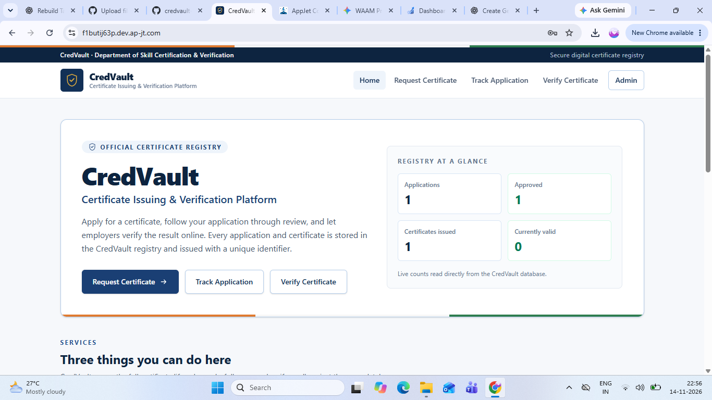
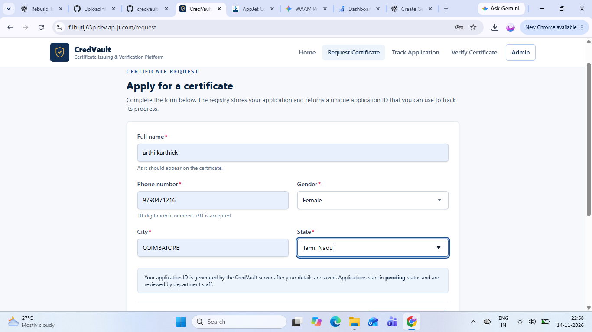
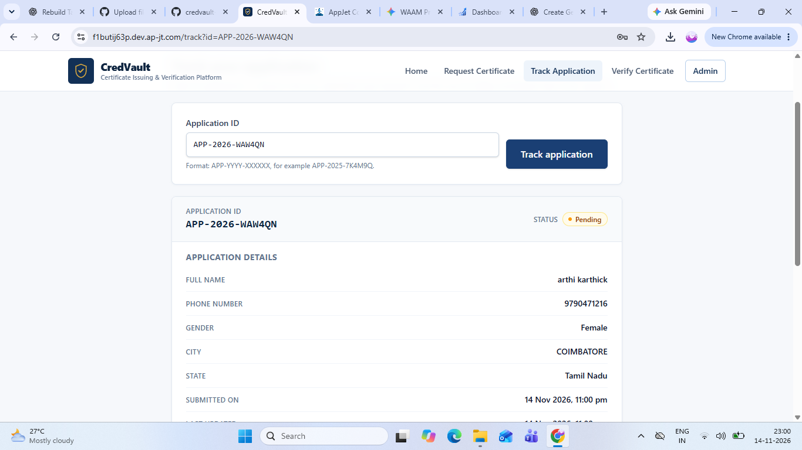
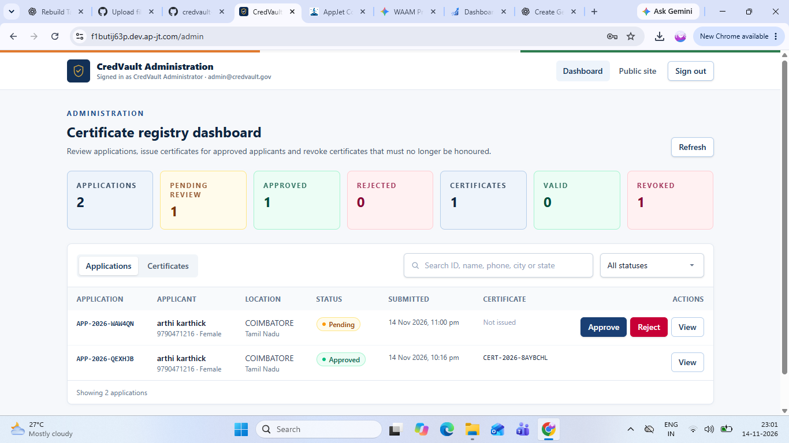
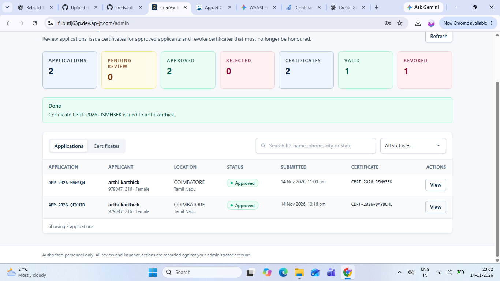
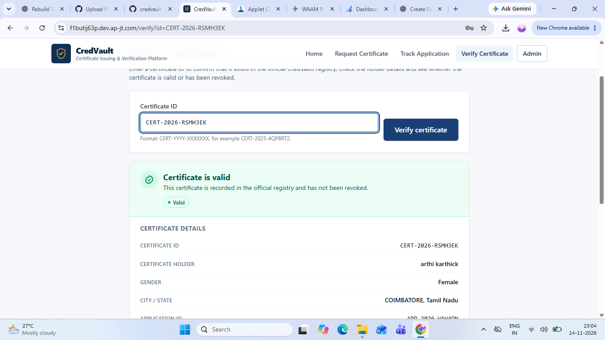
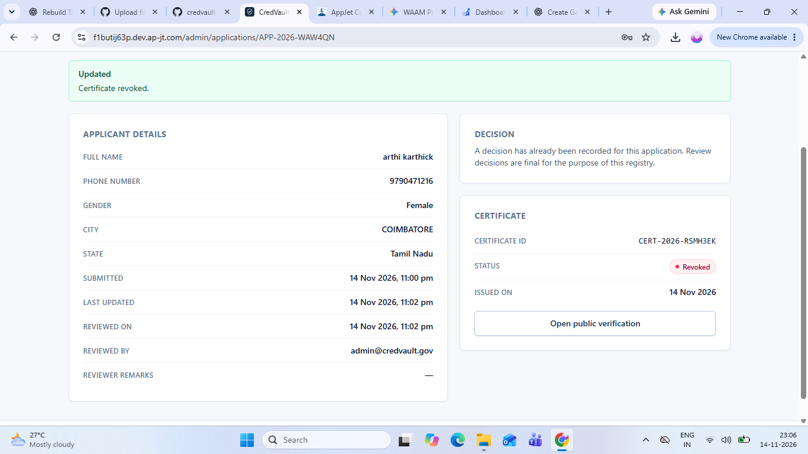

# CredVault — Certificate Issuing & Verification Platform

CredVault is a full-stack Certificate Issuing & Verification Platform developed for the **ELEVATE Software Development Engineer Internship — Task 4**.

The platform allows applicants to request certificates, track application progress, and verify issued certificates. Administrators can securely manage applications, approve or reject requests, issue certificates, and revoke certificates when necessary.

## Features

### Public Portal
- Home page with platform information and navigation.
- Certificate request form.
- Automatic generation of unique Application IDs.
- Application tracking using Application ID.
- Public certificate verification using Certificate ID.
- Clear status indicators for pending, approved, rejected, valid and revoked records.

### Administrator Portal
- Secure administrator login.
- Protected admin dashboard.
- Application statistics and certificate statistics.
- View, search and filter applications.
- Approve or reject applications with remarks.
- Issue certificates for approved applications.
- View and search issued certificates.
- Revoke certificates with a mandatory reason.

## Technology Stack

| Layer | Technology |
|---|---|
| Frontend | React 19, Vite, TypeScript |
| Styling | Tailwind CSS v4 |
| Backend | Node.js, Express 5, TypeScript |
| Database | SQLite using sql.js |
| Authentication | JWT |
| Password Security | bcryptjs |
| Validation | Server-side validation |

## Project Structure

```text
credvault/
├── client/
│   ├── index.html
│   ├── vite.config.ts
│   └── src/
│       ├── auth/
│       ├── components/
│       ├── lib/
│       ├── pages/
│       ├── App.tsx
│       └── main.tsx
├── server/
│   ├── config.ts
│   ├── db.ts
│   ├── index.ts
│   ├── middleware/
│   ├── routes/
│   ├── mappers.ts
│   ├── types.ts
│   ├── utils/
│   └── validation.ts
├── scripts/
│   └── smoke-test.js
├── data/
├── .env.example
├── .gitignore
├── Dockerfile
├── package.json
├── package-lock.json
└── tsconfig.json
```

## Application Screenshots

The following screenshots demonstrate the main application workflows.

Create a `screenshots` folder in the repository and upload the seven project screenshots using these filenames.

| No. | Screenshot | Filename |
|---|---|---|
| 1 | Home page | `01-home.png` |
| 2 | Certificate request confirmation | `02-request-success.png` |
| 3 | Application tracking | `03-track-application.png` |
| 4 | Administrator dashboard | `04-admin-dashboard.png` |
| 5 | Application management and review | `05-application-management.png` |
| 6 | Certificate verification — valid | `06-valid-certificate.png` |
| 7 | Certificate verification — revoked | `07-revoked-certificate.png` |
### 1. Home Page


### 2. Certificate Request Confirmation


### 3. Application Tracking


### 4. Administrator Dashboard


### 5. Application Management


### 6. Valid Certificate Verification


### 7. Revoked Certificate Verification


## Installation

### Requirements
- Node.js 20 or newer
- npm

### Clone the repository

```bash
git clone <your-repository-url>
cd credvault
```

### Install dependencies

```bash
npm install
npm --prefix client install
```

### Configure environment variables

Create a `.env` file using `.env.example`.

Configure your own administrator email, password and JWT secret.

Never commit your actual `.env` file or expose secret values in the repository.

## Environment Variables

| Variable | Purpose |
|---|---|
| `PORT` | Backend server port |
| `NODE_ENV` | Application runtime mode |
| `JWT_SECRET` | Secret used for JWT signing |
| `JWT_EXPIRES_IN` | Administrator session duration |
| `DB_PATH` | SQLite database location |
| `ADMIN_EMAIL` | Administrator email |
| `ADMIN_PASSWORD` | Administrator password |
| `ADMIN_PASSWORD_HASH` | Optional pre-hashed administrator password |
| `ADMIN_NAME` | Administrator display name |
| `BCRYPT_ROUNDS` | Password hashing cost factor |

## Running the Application

### Production Build

```bash
npm run build
npm start
```

### Development Mode

Start the backend:

```bash
npm run dev:server
```

Start the frontend in another terminal:

```bash
npm run dev:client
```

The development frontend runs at:

`http://localhost:5173`

The backend runs at:

`http://localhost:4000`

## Database

CredVault uses SQLite through sql.js.

The database contains the following main tables:

- `admins` — administrator accounts.
- `applications` — submitted certificate applications.
- `certificates` — issued certificate records.

Application IDs and Certificate IDs are generated by the backend.

Database records include application status, review remarks, certificate status, issue details and revocation details.

The application writes database changes to the configured database file. Persistent storage on the hosting platform depends on the configured storage volume.

## API Reference

### Public API

| Method | Endpoint | Description |
|---|---|---|
| GET | `/api/health` | Server health check |
| GET | `/api/stats` | Public registry statistics |
| POST | `/api/applications` | Submit an application |
| GET | `/api/applications/:id` | Track an application |
| GET | `/api/certificates/:id` | Verify a certificate |

### Administrator API

Protected endpoints require a valid JWT.

| Method | Endpoint | Description |
|---|---|---|
| POST | `/api/admin/login` | Administrator login |
| GET | `/api/admin/me` | Administrator profile |
| GET | `/api/admin/stats` | Dashboard statistics |
| GET | `/api/admin/applications` | List and search applications |
| GET | `/api/admin/applications/:id` | Application details |
| PATCH | `/api/admin/applications/:id` | Approve or reject an application |
| POST | `/api/admin/applications/:id/certificate` | Issue a certificate |
| GET | `/api/admin/certificates` | List certificates |
| POST | `/api/admin/certificates/:id/revoke` | Revoke a certificate |

## Business Rules

- Only approved applications can receive certificates.
- A certificate can only be issued once per application.
- Rejected applications cannot receive certificates.
- Certificate revocation requires a reason.
- Application review decisions are recorded with administrator details and timestamps.
- Invalid Application IDs and Certificate IDs return appropriate not-found responses.

## Testing

The project includes automated testing scripts.

Run the tests using:

```bash
npm test
```

Additional checks:

```bash
npm run typecheck
npm run build
```

The project documentation reports **40 passing assertions** in its automated smoke-test suite.

Major workflows include:

- Application submission and ID generation.
- Application tracking.
- Administrator authentication.
- Application approval and rejection.
- Certificate issuance.
- Public certificate verification.
- Certificate revocation.
- Invalid ID handling.
- Database persistence testing.

## Security

- Administrator passwords are hashed using bcryptjs.
- Protected administrator endpoints require JWT authentication.
- Server-side validation is used for incoming requests.
- Login attempts are rate-limited.
- Helmet provides HTTP security headers.
- Environment secrets are kept on the server.
- Actual credentials and `.env` files must not be committed to GitHub.

For production use, configure a strong JWT secret, secure administrator credentials and HTTPS.

## Deployment

The project includes a Dockerfile for building and running the application.

```bash
docker build -t credvault .
```

```bash
docker run -p 4000:4000 credvault
```

Configure environment variables and persistent storage before production deployment.

## Live Application

**Live Demo:** https://f1butij63p.dev.ap-jt.com

**GitHub Repository:** https://github.com/arthikarthick07/credvault-elevate-task4

## Project Information

**Project:** CredVault — Certificate Issuing & Verification Platform

**Internship:** ELEVATE — Software Development Engineer Intern

**Task:** Task 4 — Full Stack Integration

**Developer:** Arthi Karthick

## License

This project is developed for the ELEVATE Software Development Engineer Internship — Task 4.
